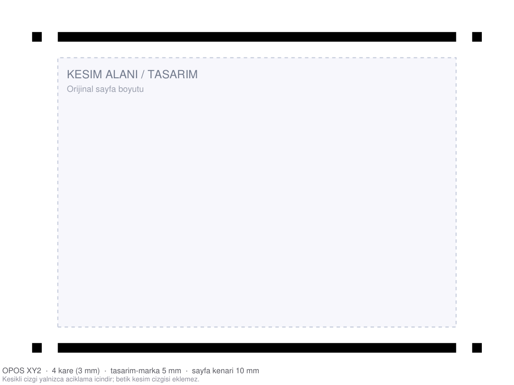
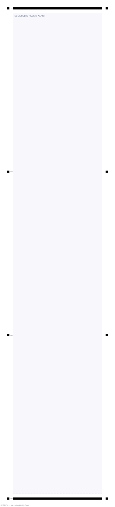

# Summa OPOS Regmark · CorelDRAW macOS

[Türkçe](README.md) | **English**

A JavaScript script that runs **inside** CorelDRAW and places Summa OPOS
registration marks around the **selected object** (or the page if nothing is
selected). It is the macOS equivalent of the Windows Summa/GoSign plug-in,
without installing a plug-in.



## Why not a plug-in?

Summa's CorelDRAW plug-in is Windows-only (COM/VBA components). CorelDRAW for
macOS cannot load these plug-ins. However, CorelDRAW macOS supports automation
through **JavaScript** (`Window > Inspectors > Scripts`). These scripts target
that environment and draw the marks directly into the document as vectors.

## What it does

- If an **object is selected**, it places the marks around that object's
  bounding box and sizes the page to **selection + marks**.
- If **nothing is selected**, it uses the active page (legacy behaviour).
- Draws **4 black squares** (OPOS X); for **OPOS XY** it adds a bottom line,
  for **OPOS XY2** a bottom and a top line.
- For long jobs it adds **equally spaced extra mark rows** along the left and
  right edges.
- Squares are **100% K (CMYK 0/0/0/100)** with no outline.
- Puts the marks on a separate **`Regmark`** layer and locks the layer.
- Can be run repeatedly: it removes the old `Regmark` layer and does not grow
  the page again if the selection is unchanged.

Defaults:

| Setting | Value |
|---|---|
| Mark size | 3 mm |
| Design-to-mark gap | 5 mm |
| Page edge margin | 10 mm |
| Mark spacing (long jobs) | at most 300 mm |
| Mark frame | 18 mm per side (3 + 5 + 10) |
| Page size | preserved; grows only if the marks do not fit |

## Installation

### Clone

```bash
git clone https://github.com/ewolution/coreldraw-summa-regmark.git
cd coreldraw-summa-regmark
./Kur.command
```

### ZIP / folder

1. **Double-click** `Kur.command`.
2. If macOS says the developer cannot be verified: **right-click → Open**.
3. The scripts are copied to (whichever versions exist: 2024/2025/2026):

```
~/Library/Application Support/Corel/CorelDRAW Graphics Suite 2026/Draw/Scripts/
```

For a manual install, copy the `.js` files from `scripts/` into that folder.

## Usage

1. Open your document in CorelDRAW (save it first).
2. **Window > Inspectors > Scripts**
   (Turkish UI: **Pencere > Denetçiler > Komut Dosyaları**).
3. Select **JavaScript > User Scripts** on the left.
4. Double-click the script that matches your cutter:

| Script | When? |
|---|---|
| `Summa-OPOS-X.js` | Cutter in OPOS **X** mode |
| `Summa-OPOS-XY.js` | Cutter in OPOS **XY** mode |
| `Summa-OPOS-XY2.js` | Cutter in OPOS **XY2** mode |
| `Summa-Kesim-Ayir.js` | Add regmarks, then separate magenta cut lines |
| `Summa-Regmark-Kaldir.js` | Remove the marks/layer |
| `Summa-Test.js` | API/selection diagnostic |

A summary dialog appears after the script runs (page size, cut area, mark
count, row count and spacing). The script's dialog texts are in Turkish.

> If the scripts are not listed, restart CorelDRAW. If they are still missing,
> use **Load** in the Scripts panel and point it to `.../Draw/Scripts` once.

## Changing the settings

CorelDRAW's JavaScript environment has no dialog UI, so settings live in the
`AYAR` block at the top of each script:

```js
var AYAR = {
  markaBoyutu: 3.0,      // mark size; must match the cutter's "mark size"
  tasarimBosluk: 5.0,    // gap between the design edge and the mark
  sayfaKenari: 10.0,     // margin between the mark and the page edge
  markaAraligi: 300.0,   // max distance between mark rows on long jobs (mm)
                         // 0 = corner marks only
  oposTipi: "XY2",       // "X" | "XY" | "XY2"
  secimeGore: true,      // true: use the selected object
  sayfaBuyut: true,      // true: grow the page if the marks do not fit
                         // false: never change the page (warn if they do not fit)
  katmanAdi: "Regmark"
};
```

Edit the file in TextEdit, save it and run the script again. You do not need to
run `Kur.command` again; the file in the Scripts folder is used directly.

**Important:** `markaBoyutu` and `oposTipi` must match the cutter's OPOS
settings exactly. A wrong size or mode means the cutter will not find the marks.

## Selection / page size

1. **Select** the object (or group) you want to mark in CorelDRAW.
2. Run the script.
3. The script measures the selection's bounding box and places the **4 squares
   exactly at the object's edges**. The page is **never shrunk**; it grows only
   as much as needed for the marks to fit, and the content is shifted
   accordingly.

- With **no selection**, the page is used and grown by 18 mm on each side.
- `sayfaBuyut: false`: the page never changes. If the selection is too close to
  the edge and the marks would fall outside, the script warns and does nothing.
- `secimeGore: false` ignores the selection and uses the page.
- Objects outside the selection stay on the page as they are (the page is not
  shrunk, so they are not cropped).

If there are locked objects or locked layers, the script does not change the
page and shows a warning. Unlock them and run it again.

## Extra mark rows for long jobs

For large/long jobs a single row of corner marks is not enough: the OPOS sensor
feeds the media back and forth too much, which reduces accuracy. The script adds
**equally spaced** extra mark rows along the left and right edges, based on the
cut height.

- `markaAraligi` (default **300 mm**): maximum distance between two rows.
- The first row is the bottom corner, the last row is the top corner; the rows
  in between are distributed evenly.
- Set it to `0` to draw only the 4 corner squares.

Example:

| Cut height | Rows | Spacing |
|---|---|---|
| 100 mm | 2 | 113 mm |
| 405 mm | 3 | 209 mm |
| 600 mm | 4 | 204 mm |
| 900 mm | 5 | 228 mm |



Detailed layout, cutter settings and references:
**[docs/opos-mark-layout.en.md](docs/opos-mark-layout.en.md)**

Code and API details:
**[docs/technical-details.en.md](docs/technical-details.en.md)**

## Separating magenta cut lines

`Summa-Kesim-Ayir.js` **adds OPOS XY registration marks first**, then separates
lines painted with **exact CMYK 0/100/0/0**.

- With a **selection**, only the selected objects are separated and the regmarks
  are placed **around the selection**.
- With **no selection**, the page is used.

There is **no tolerance**: 99.9 or 90 magenta is not selected; the line must be
exactly 0/100/0/0. A spot colour name (`Cut`, `Kesim`, etc.) alone is not enough.

```js
var AYAR = {
  kesimCmyk: [0, 100, 0, 0], // exact match, no tolerance
  yeniSayfa: true,           // true: new page, false: "Kesim" layer on the same page
  kesimKatmani: "Kesim",

  // OPOS regmarks (must match the OPOS scripts)
  markaBoyutu: 3.0,
  tasarimBosluk: 5.0,
  sayfaKenari: 10.0,
  markaAraligi: 300.0,

  // Outline width of the cut copy made from a mixed object (mm)
  kesimCizgiKalinligi: 0.5
  // OPOS XY is fixed: 4 squares + bottom line
};
```

- `yeniSayfa: true` (default): page 1 = **print + regmarks**, page 2 =
  **cut + regmarks**. Both pages have the same size.
- `yeniSayfa: false`: a **`Kesim` layer** on the same page + regmarks. Hide that
  layer for the print PDF and the design layers for the cut PDF.
- In this flow the **`Regmark` layer is not locked**, so you can edit it at any time.

### Workflow

1. **Select** the objects you want to separate (skip the selection for the whole page).
2. Run `Summa-Kesim-Ayir`.
3. Page 1 is the print file, page 2 the cut file; both already have OPOS XY regmarks.
4. Export page 1 as the print PDF and page 2 as the cut PDF.

You do not need to run the OPOS script separately; the separation script adds the
marks to both pages.

### Limitations

- Magnetas other than **exact 0/100/0/0** are not selected (no tolerance).
- With a selection, only the selected objects are processed; without one, the
  whole page.
- The regmarks are OPOS **XY** (4 squares + bottom line); no top line.
- **Groups are supported:** a group made entirely of cut-colour objects is moved
  intact. A mixed group (design + cut) is ungrouped one level and its cut objects
  are separated.
- Groups containing a **PowerClip** are skipped for safety; ungroup them manually.
- Magenta pixels inside **bitmaps** cannot be separated (only vector colours are
  inspected).
- Objects with a **design fill + magenta outline** are duplicated: the original
  fill stays on page 1; the copy keeps a **transparent interior** and only its
  **outline/stroke is magenta** on page 2. Contour effects are cleared on the
  copy (e.g. text + magenta contour).
- `pdf-bicak` works at the PDF content-stream level; this script works at the
  CorelDRAW **object** level. They complement each other for complex files.

## Workflow notes

- **Print:** publish to PDF from CorelDRAW as usual; the marks are on the
  `Regmark` layer and are included in the output.
- **Cut:** keep your cut lines on a separate layer. Summa software (GoSign /
  WinPlot) recognises the `Regmark` layer as registration marks; do not put the
  marks on the cut layer or they may be cut.
- **Scale:** print at **100% / Actual size**; disable “fit to page”.
- **Cutter:** the OPOS mode (X / XY / XY2), mark size and design-to-mark
  distance must match the cutter's OPOS parameters.
- **Test:** make a small test print and a test cut first. On glossy vinyl or
  lamination the OPOS sensor may need a media calibration.
- **Undo:** the script modifies the document. Save the file first; use `Cmd+Z`
  or `Summa-Regmark-Kaldir.js` to remove the marks. The page size is not shrunk
  automatically.

## Limitations

- Only the **selection on the active page** is processed (run it per page in a
  multi-page document).
- The page is never shrunk to the selection; it only grows if the marks do not
  fit.
- Content on the master page does not move when the page grows; keep the design
  on a normal layer.
- There is no UI other than `alert`, so settings are edited in the file.
- The Windows plug-in's barcode / job-number features are not included.

## Troubleshooting

| Symptom | Fix |
|---|---|
| Scripts are not listed | Restart CorelDRAW; use **Load** to point at the Scripts folder |
| “No open document” | Open a `.cdr` file first |
| “Page too small” | Reduce the measurements or use a larger page |
| “Locked object/layer” | Unlock the layers/objects or set `sayfaBuyut: false` |
| Extra marks cause misalignment | Match `markaAraligi` to the cutter's OPOS panelling/panel size; make sure the cut file has the same page geometry as the print |
| “Selection could not be read” | Run `Summa-Test` and check the reported API state. If running from the Scripts panel clears the selection, assign a shortcut under `Tools > Customization > Commands > Scripts` and run it with the object selected. |
| Page did not grow | Is `sayfaBuyut` `true`? If a `Regmark` layer already exists, the page is not grown again |
| Cutter cannot find the marks | Same mark size/mode as the cutter? Enough white space? Is the print at 100%? |
| Marks in the wrong place | Check `tasarimBosluk` and `sayfaKenari` |

## Development / tests

The scripts are generated from a single template:

```
src/regmark.template.js   →  tools/build.py  →  scripts/*.js
```

```bash
python3 tools/build.py
node tests/mock_coreldraw.js
```

`tests/mock_coreldraw.js` mocks the CorelDRAW API and tests geometry, layer
behaviour, selection geometry, long-job mark rows, lock handling, repeated
runs and magenta cut separation (selection, page, group and mixed fill/outline, 25/25 passing).

## License

MIT © 2026 ewolution. See [LICENSE](LICENSE).
